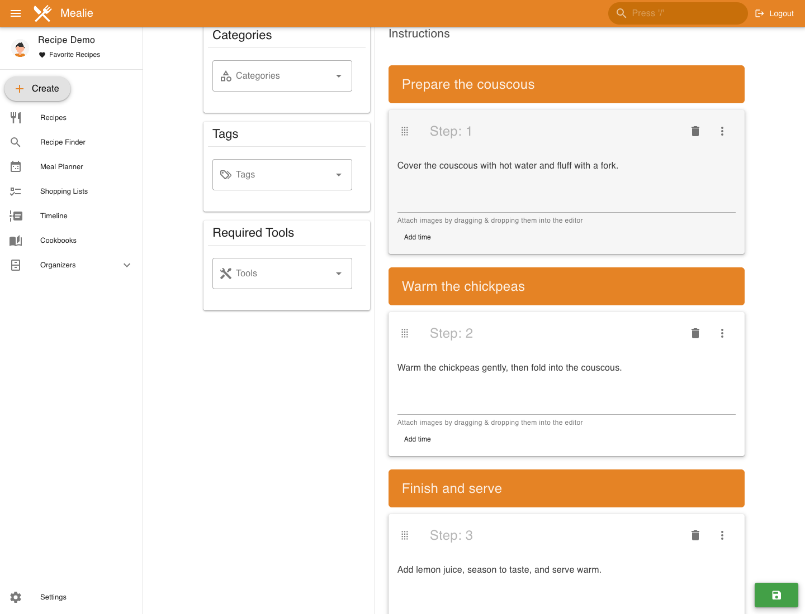
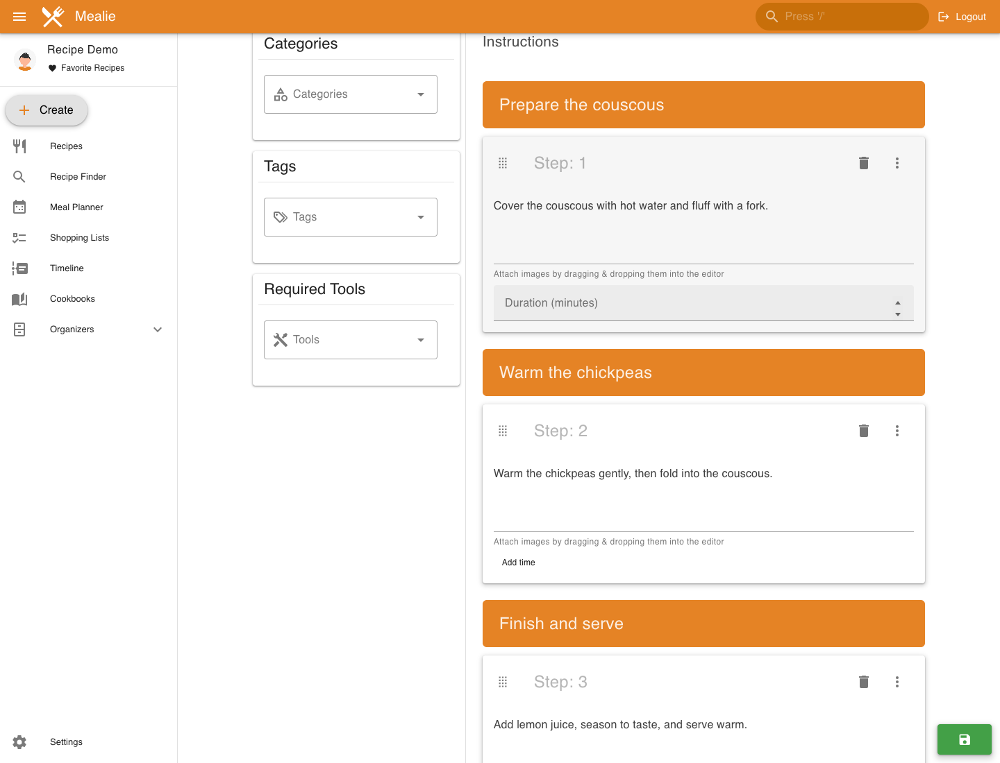
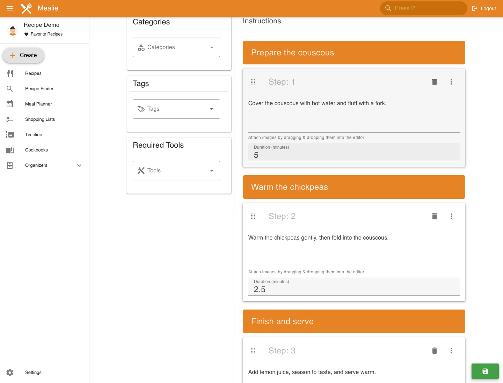

# Mealie step-duration screenshots

Captured 2026-10-13 from the actual local Mealie Nuxt frontend and FastAPI backend, with a disposable SQLite database and synthetic Recipe Demo account/recipe. No mocked components or intercepted API responses.

- Option A / PR #8705: `d6edd7f770a8297da63c4258c22dd855023372bd`
- Option B / PR #8706: `7ed33f1babef3a1f8849d8a86431f84136c7a080`
- Same recipe: Lemon Chickpea Couscous, three instruction steps.
- Both: entered 5 and 2.5 minutes through the actual edit UI, saved successfully (HTTP 200), reloaded, and reopened the editor. API readback showed `durationSeconds: [300, 150, null]`; the reader displayed `5m` and `2m 30s` with no duration on the third step.
- A: optional empty duration fields are always visible in edit mode; reopened values were 5, 2.5, blank.
- B: Add time precedes the field. Clicking it reveals an empty input, not 0. Reopened timed steps show 5 and 2.5; the untimed third step retains Add time.

This is bounded local UI/save/reopen evidence, not a claim of full CI or a full regression suite. Screenshots were visually inspected; only synthetic recipe/account data appears. Reviewed source commits were not changed. Images are stored on a separate evidence-only branch.

## Option A

## Option B

